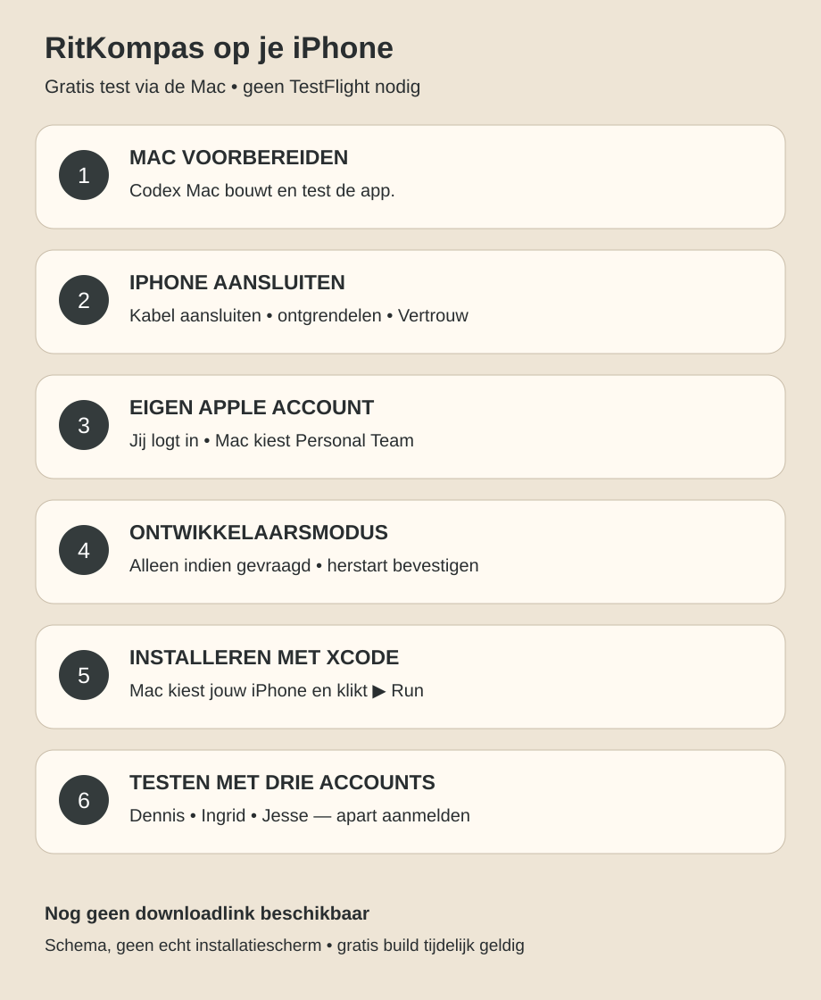

# RitKompas op je iPhone testen — gratis via de Mac

**Er is nog geen bevestigde downloadlink.** De gratis route installeert de testapp vanuit Xcode op de aangesloten iPhone. Een link naar GitHub of de website installeert deze native app niet. De website kan wel direct in Safari worden geopend: https://rittenregistratie.zsj4j2s4df.workers.dev (beveiligde aanmelding).

1. **Mac voorbereiden — Codex Mac.** Neem de nieuwste overeengekomen code over, bouw/test die en open het bestaande RitKompas-apphostproject in Xcode. Geen betaalde diensten nodig.
2. **Jij: iPhone aansluiten.** Ontgrendel je iPhone, verbind met een datakabel en kies **Vertrouw** als daarom gevraagd wordt. Voer je toestelcode alleen zelf op je toestel in.
3. **Jij: eigen Apple Account.** Meld persoonlijk aan in Xcode → Settings → Accounts wanneer nodig. Mac kiest bij Signing & Capabilities jouw bevestigde **Personal Team** en de aangesloten iPhone. Geen wachtwoorden of 2FA-codes aan een agent geven. Laat Mac concrete signingfouten oplossen zonder betaald lidmaatschap aan te schaffen.
4. **Jij: ontwikkelaarsmodus indien gevraagd.** Op iPhone: Instellingen → Privacy en beveiliging → Ontwikkelaarsmodus. Schakel in, herstart en bevestig alleen voor deze bewuste test. Dit onderdeel kan pas zichtbaar worden na koppeling met Xcode. Ontbreekt het, laat Mac eerst het toestel/build controleren.
5. **Codex Mac: installeren en starten.** Selecteer jouw iPhone in Xcode en klik ▶ Run. Als iOS expliciet een ontwikkelaar laat vertrouwen: Instellingen → Algemeen → VPN en apparaatbeheer → de zojuist gebruikte ontwikkelaarsidentiteit → Vertrouw. Doe dit uitsluitend voor je eigen bevestigde testbuild. Menunamen kunnen per versie verschillen.
6. **Samen testen.** Open RitKompas. Test apart Dennis, Ingrid en Jesse met eigen aanmelding en bestaande rechten. Controleer opslaan én herladen, accountwisseling en meldingen. Geef locatie-/meldingstoegang pas wanneer de geteste functie daarom vraagt en Mac uitlegt wat werkelijk aangesloten is.

Gratis Personal Team-builds zijn doorgaans ongeveer **7 dagen** geldig; daarna kan opnieuw installeren/ondertekenen via de Mac nodig zijn. Apple kan toestel-/appbeperkingen toepassen. Geen TestFlight- of App Store-download beloofd. Voor latere distributie eerst de concrete Applevoorwaarden en eventuele kosten beoordelen.

## Wat jij moet doen

Wees bij de Mac met je ontgrendelde iPhone en kabel. Houd je eigen Apple-aanmelding bij de hand. Dennis, Ingrid en Jesse moeten ieder zelf hun bestaande RitKompas-aanmelding kunnen voltooien. Dit vereist niet automatisch drie iPhones: afzonderlijke sessies kunnen accountwisseling testen; gelijktijdige gebruikers-/CarPlayproeven vereisen later passende echte toestellen.

## Wat Mac teruglevert

Exacte commit/build, toestel-/iOS-versie zonder serienummer, signingroute zonder privégegevens, install/start/herstart-resultaat en de drie-accountmatrix uit MAC_FINISH_AND_RELEASE.md. Markeer prototype, centrale functionaliteit en automatische ritdetectie afzonderlijk. Niet aangesloten functies blijven eerlijk NIET GETEST/niet beschikbaar. Deze handleiding is een schema, geen screenshot of bewijs dat installatie al is geslaagd.
